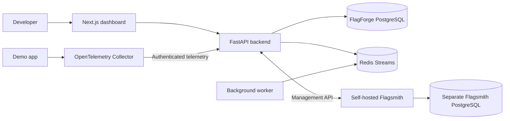

<div align="center">

# ⚒️ FlagForge

### Feature-flag intelligence for safer releases

**Find where flags are used. Understand their impact. Make better release decisions.**

[](https://github.com/Flagsmith/flagsmith)


[Repository](https://github.com/shivamBhela/FlagForge) · [Architecture](docs/ARCHITECTURE.md) · [Setup](docs/DOCKER_SETUP.md) · [Limitations](docs/KNOWN_LIMITATIONS.md)

</div>

---

## What is FlagForge?

Feature flags make it easier to release software gradually, but their references, dependencies and operational impact can become difficult to track. **FlagForge adds a layer of release intelligence around [Flagsmith](https://github.com/Flagsmith/flagsmith)**—helping teams inspect flag usage, estimate impact, review runtime signals and make informed rollout decisions.

Flagsmith remains the feature-flag provider and source of truth. FlagForge does not replace it.

## At a glance

| Capability | Purpose |
|---|---|
| 🔎 **Code Scanner** | Finds supported flag references in Python, JavaScript and TypeScript. |
| 🕸️ **Dependency Intelligence** | Maps inferred flag-to-component-to-service relationships and estimates blast radius. |
| 📈 **Runtime Monitor** | Displays request, error and latency observations when telemetry is available. |
| 🛡️ **Release Guardian** | Calculates a deterministic release-risk score and recommends review actions. |
| 🧪 **Chaos Lab** | Demonstrates synthetic Staging scenarios without load generation or provider changes. |
| 🧹 **Cleanup Studio** | Helps review stale references and prepare human-approved cleanup changes. |
| 🔗 **Flagsmith Integration** | Imports project, environment, feature and environment-state metadata through the Management API. |
| 💻 **Companion CLI** | Provides local scanning and read-only flag/environment inspection helpers. |

## How it works

1. **Connect Flagsmith** — configure a self-hosted instance using an Organization Management API key.
2. **Sync flag metadata** — FlagForge stores tenant-scoped copies in its own database; Flagsmith keeps its own separate database.
3. **Scan the codebase** — collect flag references with file, line and evidence details.
4. **Map dependencies and observe runtime** — infer potential impact and use authenticated OpenTelemetry observations when available.
5. **Assess and review** — inspect the risk score, run a synthetic scenario or prepare a human-reviewed cleanup.

## Risk scoring

The deterministic score ranges from **0 to 100**:

```text
30% dependency impact + 25% error anomaly + 20% latency anomaly
                 + 15% change criticality + 10% rollout velocity
```

| Score | Level | Recommendation |
|---:|---|---|
| 0–29 | 🟢 Low | Allow rollout |
| 30–49 | 🟡 Moderate | Proceed with canary |
| 50–74 | 🟠 High | Manual approval |
| 75–100 | 🔴 Critical | Manual approval |

Missing telemetry is not considered healthy telemetry. When evidence is insufficient, the engine applies conservative inputs and requires manual review. Scores are advisory—not a guarantee that a release is safe.

**Rollback is disabled:** safe conditional-write behaviour has not been established. The rollback endpoint returns HTTP `501` and does not change provider state.

## Architecture



FlagForge and Flagsmith use separate databases. Integration happens through the supported Flagsmith Management API; FlagForge never accesses Flagsmith's SQL database directly.

## Technology

- **Frontend:** Next.js 16, React 19, TypeScript, Tailwind CSS
- **Backend:** Python 3.11+, FastAPI, Pydantic v2
- **Data:** PostgreSQL 16, SQLAlchemy async, Alembic, Redis 7
- **Provider:** Official self-hosted Flagsmith `v2.295.2`
- **Observability & runtime:** OpenTelemetry Collector, Docker Compose
- **CLI:** Python companion to the official Flagsmith CLI

## Getting started

**Prerequisites:** Docker Desktop with Linux containers, Docker Compose v2 and PowerShell 7 (recommended). The Full profile needs more memory; use Core on a constrained machine.

```powershell
git clone https://github.com/shivamBhela/FlagForge.git
cd FlagForge
.\setup.ps1 -Profile Full
```

The setup script creates a local `.env` with generated secrets when needed, starts the selected services and runs health checks. It preserves an existing `.env` and named data volumes. It prints the service addresses for your machine after startup; these are intentionally not listed here.

| Profile | Includes |
|---|---|
| `Core` | API, worker, databases, Redis and Flagsmith |
| `Dashboard` | Core + web dashboard |
| `Observability` | Core + Collector and demo app |
| `Full` | Core + dashboard + observability |

Useful commands:

```powershell
.\scripts\health-check.ps1 -Profile Full
.\scripts\stop.ps1
```

The stop script preserves data. **Do not use `docker compose down -v` unless you intend to delete the project databases and Redis data.** See [Docker setup](docs/DOCKER_SETUP.md) for details.

## Connect Flagsmith

1. Start the Core or Full profile and complete the initial Flagsmith administrator setup.
2. Create a dedicated demo organization, project, and Development and Staging environments.
3. In Flagsmith **Organization Settings → API Access**, create an Organization Management API key.
4. In FlagForge, open **Integrations**, select **Flagsmith Local**, enter the internal Compose service API address configured by the example environment, test the connection and sync.

The Organization Management API key is different from an environment SDK key and a dashboard password. Keep credentials out of source code and browser-visible variables. Follow the [Flagsmith setup guide](docs/FLAGSMITH_SETUP.md).

## Companion CLI

The companion CLI delegates supported provider commands to the official Flagsmith CLI and adds local source scanning. It is **not** an official Flagsmith plugin or fork.

```powershell
python -m pip install -e .\cli
flagforge --help
flagforge doctor
flagforge scan .
```

CLI sync is dry-run only; environment comparison is read-only. See the [CLI guide](cli/README.md) for commands and boundaries.

## Testing

Run the main checks from the repository:

```powershell
$env:PYTHONPATH = "backend"
python -m pip install -r backend/requirements.txt
python -m pytest backend/tests/ -v

cd frontend
npm ci
npx tsc --noEmit
npm run lint
npm run build
npm run test:e2e -- --headed
```

CLI tests: `python -m unittest discover -s cli/tests -v`. See the [end-to-end report](docs/END_TO_END_TEST_REPORT.md) for the recorded test evidence.

## Status & known limitations

**Latest recorded QA: 28 November 2026.** This is a local verification snapshot, not a production-readiness score.

| Check | Recorded result |
|---|---|
| Docker Full profile | 10 long-running services healthy; migrations passed |
| Backend / CLI | 46 backend tests and 12 CLI tests passed |
| Frontend | Lint, TypeScript, build passed; 20 routes generated |
| Browser | 1 headed Playwright workflow passed; 18 route experiences covered |
| Database | Alembic at `009_encrypt_webhook_secrets`; isolated restore drill passed |
| Dependency audit | `npm audit`: 0 vulnerabilities in that run |

**Important limitations:**
- Fresh Flagsmith authentication and sync were not verified in the latest QA run. Earlier local Staging sync and webhook checks are historical, not fresh results.
- Cleanup-to-GitHub-PR is implemented but only mock-tested for the app workflow; live GitHub credentials were not configured.
- Latest browser session had no telemetry windows. Demo telemetry is not customer traffic; missing data must not be read as healthy.
- Chaos Lab is synthetic and does not generate load or mutate Flagsmith.
- Remote rollback is disabled; the endpoint returns `501` without provider mutation.
- Production hosting, TLS, high availability, production load testing and independent security testing are not verified. Do not expose this local Compose setup publicly.

For current details, see [Known limitations](docs/KNOWN_LIMITATIONS.md) and the [competition readiness report](docs/FINAL_COMPETITION_READINESS_REPORT.md). Re-run checks before making claims about a newer build.

## Repository structure

```text
FlagForge/
├── backend/       # FastAPI, models, services, migrations and tests
├── frontend/      # Next.js dashboard and browser tests
├── demo-app/      # Reference feature-flag and telemetry app
├── cli/           # Companion CLI
├── docs/          # Architecture, setup, security and QA reports
├── scripts/       # Health-check and safe-stop scripts
├── docker-compose.yml
├── setup.ps1
└── README.md
```

## Security

Use a dedicated demo Flagsmith organization, least-privilege credentials and short key expiry. Never commit `.env` files or expose server-side keys to browser code. Keep the stack local unless a separate production deployment and security review have been completed. See [Security](docs/SECURITY.md).

## Documentation

[Architecture](docs/ARCHITECTURE.md) · [Docker setup](docs/DOCKER_SETUP.md) · [Flagsmith setup](docs/FLAGSMITH_SETUP.md) · [Integrations](docs/INTEGRATIONS.md) · [Security review](docs/SECURITY_REVIEW.md) · [CLI](cli/README.md) · [QA report](docs/FINAL_COMPETITION_READINESS_REPORT.md)

---

<div align="center"><sub>Built for safer, more informed feature-flag releases.</sub></div>
