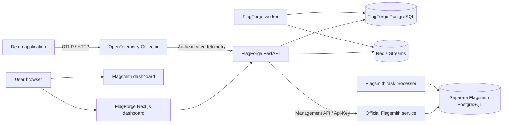

FlagForge
Feature-flag release intelligence and safety companion for self-hosted Flagsmith.
FlagForge helps engineering teams understand where feature flags are used, what parts of an application may be affected by a flag change, what release risks should be reviewed, and which cleanup actions may be appropriate. It extends the official Flagsmith platform with code intelligence, dependency visibility, runtime signals, release-risk analysis, simulation and human-reviewed cleanup workflows.
> **Project status:** FlagForge is a local-development and competition-demo prototype. It is not production-ready and should not be exposed directly to the public internet. The latest local QA run passed the core application test suite, but a fresh Flagsmith Management API connection was not verified in that run. See [Current verification and limitations](#current-verification-and-limitations).
Repository: https://github.com/shivamBhela/FlagForge  
Primary provider: Official self-hosted Flagsmith `v2.295.2`
---
Table of contents
Why FlagForge?
What FlagForge does
How it works
Architecture
Technology stack
Run locally
Connect Flagsmith
Using the modules
Companion CLI
Configuration and secrets
Testing
Current verification and limitations
Repository structure
Security notes
Documentation
Why FlagForge?
Feature flags let teams release functionality gradually, run controlled experiments and switch features on or off without redeploying an application. As a product grows, however, flag-related information can become fragmented:
A flag may be referenced across multiple files, components or services.
Engineers may not know the potential blast radius of changing a flag.
A release decision may be made without enough runtime evidence.
Old or unused flag references can remain in a codebase.
A simulated failure should not be confused with a real provider mutation or a safe rollback.
FlagForge brings these concerns into one workflow. It does not replace Flagsmith or become the source of truth for flag evaluation. Flagsmith remains the feature-flag provider; FlagForge adds analysis and decision-support around it.
What FlagForge does
Module	Purpose
Dashboard	Summarizes organizations, projects, environments, flags, scan activity and release intelligence.
Flagsmith Integration	Connects to a self-hosted Flagsmith instance through its Management API and imports project, environment, feature and environment-state information.
Code Scanner	Finds static feature-flag references in Python, JavaScript and TypeScript source and records file, line and confidence evidence.
Dependency Intelligence	Builds an inferred flag-to-component-to-service graph from discovered references and estimates downstream blast radius.
Runtime Monitor	Accepts authenticated OpenTelemetry data from the demo application and displays request, error and latency observations when data is available.
Release Guardian	Calculates a deterministic 0–100 release-risk score and recommends whether to allow, canary or manually review a rollout.
Chaos Lab	Runs labelled synthetic Staging scenarios to demonstrate how the risk workflow responds. It does not send load or mutate Flagsmith.
Incident / Risk Views	Presents risk assessments and their contributing evidence so a reviewer can understand why a release needs attention.
Cleanup Studio	Helps review possible stale flag references and prepare a human-reviewed cleanup change. External GitHub PR creation requires configured GitHub credentials.
Companion CLI	Provides local scanning, read-only flag inspection and environment comparison helpers alongside the official Flagsmith CLI.
How it works
A typical FlagForge workflow looks like this:
Flags are managed in Flagsmith. Create a project and environments such as Development and Staging in your self-hosted Flagsmith instance. Flagsmith remains the provider and source of truth.
FlagForge connects to the provider. An organization-level Management API key is entered in the Integrations screen. The backend uses the key to discover projects, environments, features and environment states. The credential is stored encrypted by the backend and is not returned to the browser.
Flag metadata is synchronized. FlagForge stores tenant-scoped copies of provider metadata in its own database. Sync jobs can be placed on the Redis Streams worker. FlagForge does not query or share Flagsmith's SQL database.
Source code is scanned. The scanner looks for supported flag access patterns and records the flag key, file path, line number, code evidence and parser confidence. A reference can be matched against known flags or marked unresolved.
Dependencies are inferred. The dependency engine links a flag to the components where it is referenced and then to an inferred service grouping. This graph is used to estimate blast radius; it is not a complete runtime dependency map.
Runtime observations can be ingested. The demo application sends OpenTelemetry data through the Collector to an authenticated FlagForge ingestion endpoint. The backend stores tenant-attributed request, error and latency observations for monitoring and risk analysis.
A release is assessed. The deterministic Risk Engine combines dependency impact, error anomaly, latency anomaly, change criticality and rollout velocity. The Release Guardian presents the result and recommended action for human review.
A scenario or cleanup can be reviewed. Chaos Lab demonstrates synthetic Staging scenarios. Cleanup Studio presents candidate references and, when GitHub access is configured, supports a reviewed change and pull-request workflow. Neither feature silently merges code or performs an automatic production rollback.
Risk scoring model
The Risk Engine uses a weighted, deterministic score bounded from 0 to 100:
```text
Risk score =
    0.30 × dependency impact
  + 0.25 × error anomaly
  + 0.20 × latency anomaly
  + 0.15 × change criticality
  + 0.10 × rollout velocity
```
The default classification is:
Score	Band	Recommended action
0–29.99	Low	`ALLOW_ROLLOUT`
30–49.99	Moderate	`PROCEED_WITH_CANARY`
50–74.99	High	`MANUAL_APPROVAL_REQUIRED`
75–100	Critical	`MANUAL_APPROVAL_REQUIRED`
The weights and policy thresholds are policy-backed. Missing telemetry is not treated as healthy telemetry: when the minimum sample/histogram evidence is unavailable, the engine assigns conservative anomaly inputs and forces manual approval. Scores are advisory decision support, not proof that a release is safe.
Remote rollback is intentionally disabled. The integration has not established a provider-side conditional-write/concurrency guarantee that would make an automated restore safe when another actor changes a flag at the same time. The rollback endpoint returns HTTP `501` without mutating provider state.
Architecture

Important separation of services
FlagForge and Flagsmith run as separate applications on the same local Docker Compose network:
FlagForge PostgreSQL stores FlagForge users, organizations, integrations, synchronized snapshots, scans, dependencies, risk assessments and telemetry records.
Flagsmith PostgreSQL stores the official Flagsmith application data.
Redis is used by FlagForge for streams, job state, locks and cache.
Flagsmith Management API is the supported integration boundary. FlagForge does not read or write Flagsmith's database directly.
Inside Docker, services reach one another by Compose service name. For example, the FlagForge API reaches Flagsmith at `http://flagsmith:8000/api/v1`. Browser-facing service addresses are assigned by the local Docker host and are printed by the setup script.
Technology stack
Layer	Technology
Frontend	Next.js 16, React 19, TypeScript, Tailwind CSS
Backend API	Python 3.11+, FastAPI, Pydantic v2
Persistence / ORM	PostgreSQL 16, SQLAlchemy 2.x async, Alembic migrations
Cache and background jobs	Redis 7, Redis Streams, worker service
Feature-flag provider	Official self-hosted Flagsmith `v2.295.2`
Observability	OpenTelemetry SDK / Collector, OTLP over HTTP
Demo workload	Local reference application that can emit telemetry and evaluate a Development environment flag when configured
Packaging	Dockerfiles and Docker Compose profiles
Companion CLI	Python 3.11+ wrapper around the official Flagsmith CLI plus a local source scanner
Run locally
Prerequisites
Windows x64 with Docker Desktop using the Linux container engine.
Docker Compose v2.
PowerShell 7 (recommended for the provided setup and health-check scripts).
At least 4 GB of memory available to Docker for the Dashboard profile. The Full profile starts additional services and needs more headroom; on a memory-constrained machine, begin with Core.
Start the Full demo
Clone the repository and open PowerShell in the project directory:
```powershell
git clone https://github.com/shivamBhela/FlagForge.git
cd FlagForge

# Start Core + Dashboard + Observability services
.\setup.ps1 -Profile Full
```
The setup script:
Checks that Docker is installed and the Docker engine is reachable.
Creates `.env` with unique local-only secrets if it does not already exist.
Preserves an existing `.env` rather than overwriting it.
Validates the Docker Compose configuration.
Starts the selected profile and runs the health-check script.
Does not delete existing named volumes.
Available profiles
Profile	Starts	Use it for
`Core`	FlagForge API, worker, PostgreSQL, Redis and official Flagsmith services	Backend and provider integration work; lowest resource use. This is the default.
`Dashboard`	Core + Next.js web dashboard	Working with the browser UI.
`Observability`	Core + OpenTelemetry Collector + demo app	Telemetry pipeline and demo workload checks without the dashboard.
`Full`	Core + Dashboard + Observability	Full interactive local demonstration.
Examples:
```powershell
.\setup.ps1 -Profile Core
.\setup.ps1 -Profile Dashboard
.\setup.ps1 -Profile Observability
.\setup.ps1 -Profile Full
```
To add optional services to an already-running Core stack:
```powershell
# Add the web dashboard
docker compose --profile dashboard up --build -d web

# Add the Collector and demo application
docker compose --profile observability up --build -d otel-collector demo-app
```
Accessing the services
The setup script prints the browser-facing addresses for the services included in the selected profile. Use those runtime-generated addresses to open the FlagForge dashboard, API documentation, Flagsmith dashboard and (when enabled) the demo application. They are intentionally not hard-coded in this README because they refer to the machine running Docker, not to a shared hosted demo.
PostgreSQL and Redis are exposed on configurable host ports for local development. Containers communicate over the Compose network using the service names `postgres` and `redis` with their standard container ports.
Check and stop services
```powershell
# Check service health and migrations
.\scripts\health-check.ps1 -Profile Full

# Stop only this project while retaining its database and Redis volumes
.\scripts\stop.ps1

# Restart with the same profile used earlier
docker compose --profile dashboard --profile observability up -d
```
> **Data safety:** Do not run `docker compose down -v` unless you intentionally want to delete the named FlagForge, Flagsmith and Redis volumes. The provided stop script preserves persisted data and does not stop unrelated Compose projects.
Connect Flagsmith
This section connects FlagForge to the official self-hosted Flagsmith service included in the local Compose stack.
Start the `Core` or `Full` profile.
Open the Flagsmith dashboard address printed by the setup script. On first launch, complete the initial administrator setup.
Create a dedicated local organization and project. Create `Development` and `Staging` environments. A `Production` environment can be added for viewing/testing policy behavior, but do not use real production flags for the demo.
Create a disposable test flag, for example `FLAGFORGE_LIVE_TEST`.
In Flagsmith Organization Settings → API Access, create an Organization API key with the shortest practical expiry.
Open the FlagForge dashboard address printed by the setup script, register/sign in, select an organization, and open Integrations.
Choose Flagsmith Local and enter this internal API base URL:
```text
   http://flagsmith:8000/api/v1
   ```
Paste the Organization API key into the integration credential field, select Test Connection, save it, and select Sync Now.
Confirm that the provider project, environments, feature definitions and environment states appear in the FlagForge feature-flag views.
Change only the disposable test flag in Flagsmith Development, run sync again, and confirm the updated state appears in FlagForge. Repeat the sync to check that duplicate snapshots are not created.
Use the Compose DNS name from the FlagForge API container. A container-local address refers to that container itself; use `flagsmith` as the provider hostname. The host-facing dashboard address is only for your browser.
Credential types are different
Credential	What it is for	Where it belongs
Organization Management API key	Discover projects, environments, flags and synchronize provider data	Enter into the FlagForge backend integration form; it is stored encrypted server-side
Environment SDK key	Evaluate flags for a specific Flagsmith environment in an application	Optional local `.env` value `FLAGSMITH_ENVIRONMENT_KEY` for the demo app only
Flagsmith dashboard login	Sign in to the Flagsmith web dashboard	Used only in the Flagsmith browser login
These credentials are not interchangeable. Never put an Organization API key or server-side SDK key in a `NEXT_PUBLIC_*` variable, source file, screenshot, issue or chat message.
The local Flagsmith setup walkthrough, including optional webhook configuration and safety notes, is documented in `docs/FLAGSMITH_SETUP.md`.
Using the modules
1. Code Scanner
The scanner examines supported source patterns and records:
Feature-flag key.
File path and line number.
A short evidence snippet.
A parser confidence value.
Whether the flag matches a known provider flag or remains unresolved.
Python scanning uses the language AST for supported function calls. JavaScript and TypeScript scanning uses known lexical patterns. Dynamic references that cannot be resolved statically should be reviewed by a developer; the scanner does not invent a flag key. This is feature-flag reference intelligence, not a universal bug detector or a complete semantic code analyzer.
2. Dependency Intelligence
The dependency engine converts scanned references into an inferred graph:
```text
Feature flag  →  Source component  →  Inferred service
```
It can show related components and services and calculate an estimated blast-radius score. The result depends on the references found and the current inference rules. Treat it as a useful map for review, not as a complete runtime service topology.
3. Runtime Monitor
The demo app can emit request counts, error counts and latency histogram observations using OTLP/HTTP. The Collector forwards the data to an authenticated FlagForge ingestion endpoint, where it is attributed to an organization, project, service and environment. Monitor and the Risk Engine can use those observations when sufficient samples and latency buckets exist.
Demo-app measurements are synthetic/local demonstration traffic, not customer production telemetry. When observations are missing or insufficient, FlagForge should display insufficient evidence rather than interpreting the absence of data as proof of health.
4. Release Guardian
The Guardian calls the deterministic Risk Engine and records the score, risk band, input factors, telemetry confidence and recommended action. Use the assessment to guide review and rollout decisions. A critical score is not a command to automatically change a provider flag; human approval is required, and remote rollback is currently disabled.
5. Chaos Lab
Chaos Lab runs controlled, labelled simulations for a Staging scenario so the risk workflow can be demonstrated without generating real load or changing remote Flagsmith state. Results are synthetic and must not be presented as a real incident, production outage or provider rollback.
6. Cleanup Studio
Cleanup Studio helps reviewers inspect possible obsolete references and prepare a cleanup proposal. The intended GitHub flow is human-reviewed: inspect the exact source file, edit the candidate, review the diff, re-check the base commit/file version, create a separate branch and open a pull request. It does not write to the default branch or merge a pull request automatically. Real external GitHub repository access and PR creation still require credentials and have not been live-verified in the latest QA pass.
Companion CLI
The companion CLI is installed separately from the web stack. Set `FLAGSMITH_API_URL` to the API base URL reachable from the machine where the CLI runs; the Docker-only service hostname shown in the integration walkthrough is not automatically reachable from a host process.
```powershell
# Install the official Flagsmith CLI using its upstream instructions first.
# Then install the FlagForge companion from the repository root:
python -m pip install -e .\cli

flagforge --help
$env:FLAGSMITH_API_URL = "<your Flagsmith API base URL>"
flagforge init --api-url $env:FLAGSMITH_API_URL
flagforge doctor
flagforge scan .
```
Available command groups include:
```text
flagforge init [--api-url URL]
flagforge doctor
flagforge flags list
flagforge flags inspect NAME
flagforge flags audit
flagforge scan [PATH]
flagforge scan-repo https://github.com/OWNER/REPOSITORY
flagforge dependencies
flagforge diff SOURCE TARGET [--no-input]
flagforge sync --dry-run
flagforge risk assess --flag KEY [--environment NAME]
flagforge cleanup preview
flagforge monitor
flagforge report [--path PATH] [--format json|markdown]
flagforge github pr
```
The companion delegates provider operations such as flag listing, inspection and environment reads to the official Flagsmith CLI. It adds local source scanning and analysis around those operations. The upstream Flagsmith CLI is a standalone Go program and does not document a plugin API; FlagForge is a companion wrapper, not an official Flagsmith plugin or fork.
CLI safety boundaries: `diff` is read-only; `sync` is dry-run only; `github pr` does not create a branch or pull request; and risk/cleanup commands require the appropriate authenticated application context. See `cli/README.md` for command details.
Configuration and secrets
The repository includes `.env.example`. The Windows setup script creates `.env` with random local secrets if the file is missing. Review `.env.example` for optional settings such as:
Local app and database ports.
Flagsmith base URL and image version.
Optional demo-app environment SDK key.
Optional GitHub App credentials.
OpenTelemetry ingestion settings.
Optional AI explanation provider settings.
Do not commit `.env`. It contains credentials and generated secrets and should remain ignored by Git. Keep provider credentials in the intended local secret/configuration path, use minimum permissions and short expiry, and rotate any credential that has been exposed.
Testing
Backend
```powershell
$env:PYTHONPATH = "backend"
python -m pip install -r backend/requirements.txt
python -m pytest backend/tests/ -v
```
Or run the backend tests in the API image:
```powershell
docker compose run --rm --no-deps --build api python -m pytest tests/ -v
```
Frontend
```powershell
cd frontend
npm ci
npx tsc --noEmit
npm run lint
npm run build
```
Browser end-to-end workflow
With the Docker stack running:
```powershell
cd frontend
npm run test:e2e -- --headed
```
Companion CLI
From the repository root:
```powershell
python -m unittest discover -s cli/tests -v
```
For more detail, see `docs/END_TO_END_TEST_REPORT.md` and `docs/FINAL_COMPETITION_READINESS_REPORT.md`.
Current verification and limitations
Latest recorded local QA snapshot: 28 November 2026. These figures describe a local test run; they are not a production-readiness rating or a competition score.
Area	Latest recorded result
Docker Full profile	10 long-running services healthy; both one-shot migration jobs exited successfully
Database	Alembic current/head at `009_encrypt_webhook_secrets`; isolated backup/restore drill passed for both PostgreSQL databases
Backend tests	46 passed
Companion CLI tests	12 passed
Frontend	ESLint, TypeScript and production build passed; 20 routes generated
Dependency audit	`npm audit` reported 0 vulnerabilities in the recorded run
Browser workflow	1 headed Playwright workflow passed in 19.8 seconds; exercised 18 route experiences and a 390px viewport
Important limitations
Fresh Flagsmith connection not verified in the latest QA run. The latest browser session showed no connected Flagsmith instance and did not make a provider request. Earlier isolated local Staging synchronization and signed-webhook checks are historical evidence, not a fresh result. Reconnect using a valid Organization Management API key and repeat the live test before claiming the integration is currently connected.
GitHub integration not live-verified for the app workflow. Cleanup-to-PR is implemented and mock-tested, but no external GitHub credentials/test repository were configured for the latest QA pass. The repository's own draft PR is publication evidence, not proof that Cleanup Studio created a PR.
Telemetry is demo telemetry. The OTLP pipeline has been exercised with local demo traffic in earlier verification, but the latest browser session displayed zero telemetry windows. Do not interpret missing observations as healthy service behavior.
Chaos Lab is synthetic only. It does not generate load or mutate the Flagsmith provider.
Remote rollback is disabled. The endpoint returns HTTP `501` and does not change provider state.
CLI sync is dry-run only. The CLI environment comparison uses read-only provider reads; live comparison was not run in the latest recorded CLI test suite.
Production hardening is incomplete. Public TLS/ingress, high availability, production load testing and independent security/penetration testing have not been verified. Do not expose the local Compose stack publicly.
The dated readiness and limitations documents are the source of truth for detailed evidence and updates. Re-run the tests and provider checks before making claims about a later build.
Repository structure
```text
FlagForge/
├── backend/                 # FastAPI application, models, services, migrations and tests
│   ├── app/
│   │   ├── api/              # API dependencies and versioned routes
│   │   ├── core/             # Configuration, auth and shared infrastructure
│   │   ├── models/           # SQLAlchemy data models
│   │   ├── schemas/          # Pydantic request/response schemas
│   │   ├── services/         # Scanner, Flagsmith, risk, telemetry, cleanup, etc.
│   │   └── worker.py         # Redis Streams worker
│   └── tests/                # Backend tests
├── frontend/                 # Next.js / React dashboard and browser tests
├── demo-app/                 # Reference app for flag evaluation and telemetry demos
├── cli/                      # FlagForge companion CLI and CLI tests
├── docs/                     # Architecture, setup, security, test and readiness docs
├── scripts/                  # Health-check and safe stop scripts
├── docker-compose.yml        # Local multi-service deployment
├── otel-collector-config.yaml
├── setup.ps1                 # Windows setup and profile launcher
├── .env.example              # Configuration template; never put real secrets here
└── README.md
```
Security notes
Use a dedicated disposable Flagsmith organization/project for local demos.
Use an Organization Management API key with minimum practical scope and expiry.
Never expose server-side keys to browser code or commit secrets.
FlagForge encrypts stored integration credentials and keeps provider calls on the backend.
The outbound provider host allowlist is intended to restrict private service access; do not broaden it casually.
Webhook signatures are verified against the raw request body; use a separate random signing secret and test only against a QA Staging environment.
Keep the application bound to local interfaces unless you have completed a separate production deployment/security review.
Do not enable automated provider rollback without a safe concurrency/conditional-write design and new verification.
Documentation
Architecture
Docker setup and data safety
Flagsmith setup
Integration details
Security guide
Security review
Known limitations
End-to-end test report
Final competition readiness report
Companion CLI guide
Official Flagsmith Docker guide
---
Acknowledgements
FlagForge is built around the official open-source Flagsmith platform. Flagsmith is deployed as a separate service and remains the feature-flag provider; FlagForge is an independent companion application.
