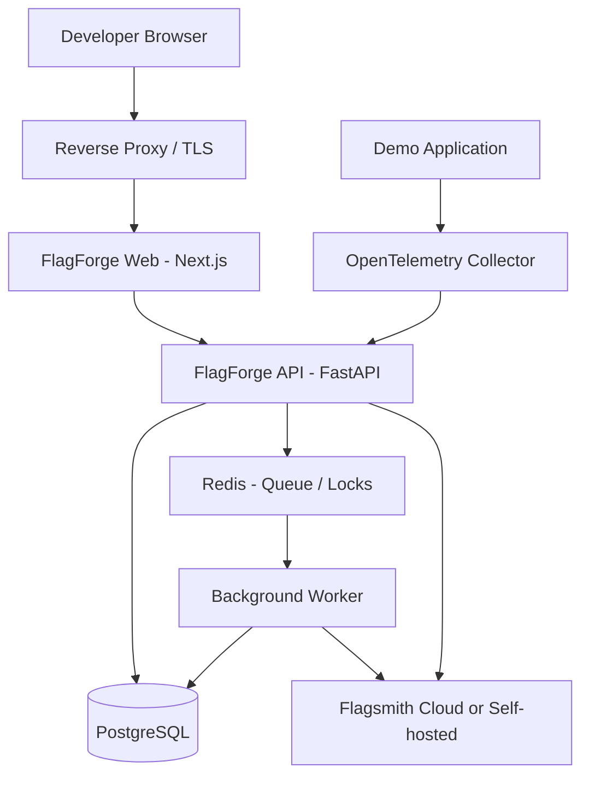
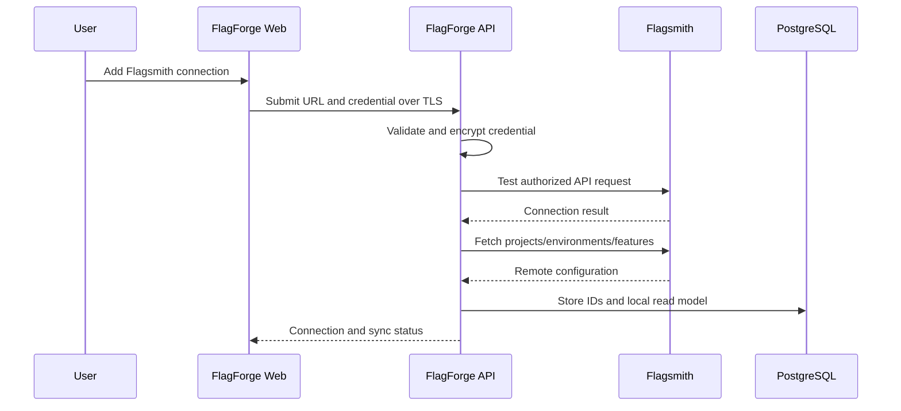
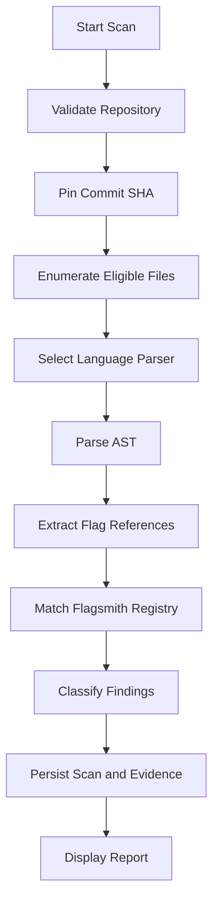
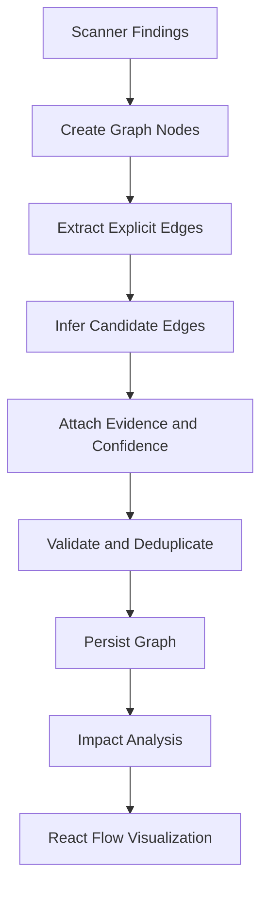
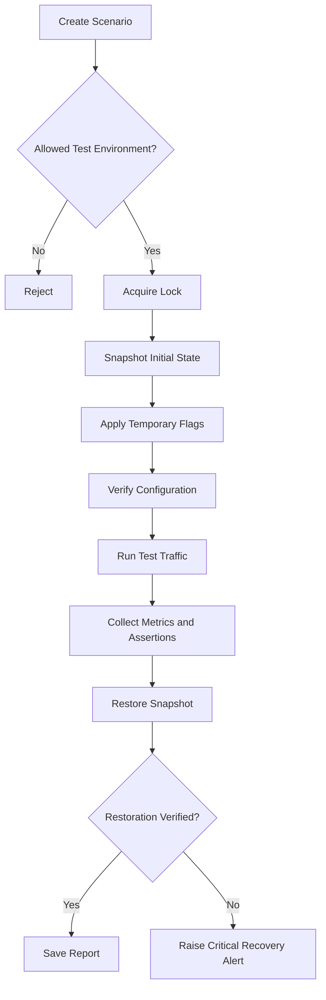
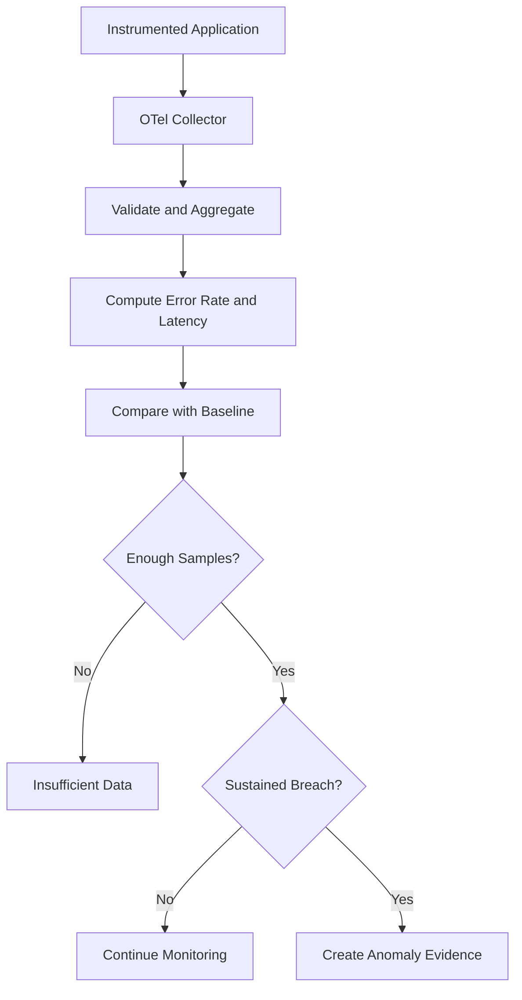
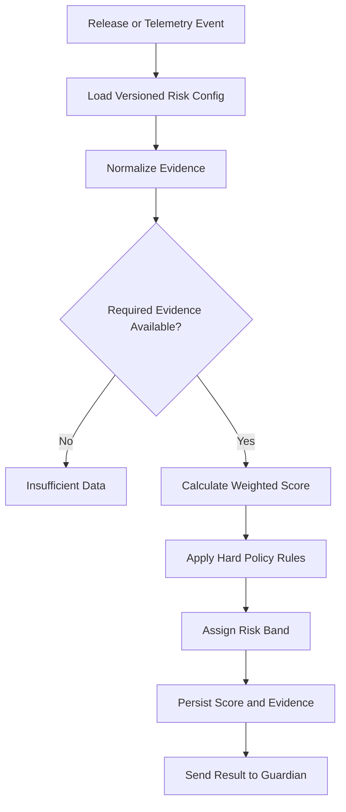
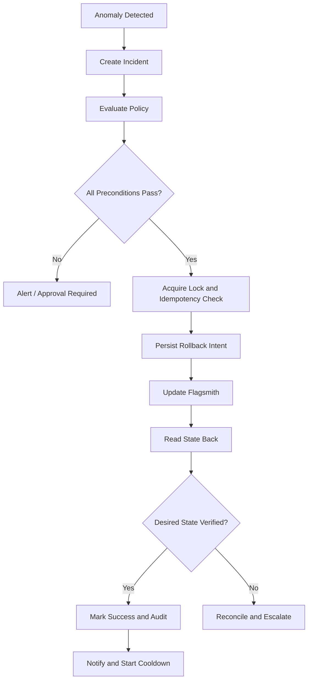
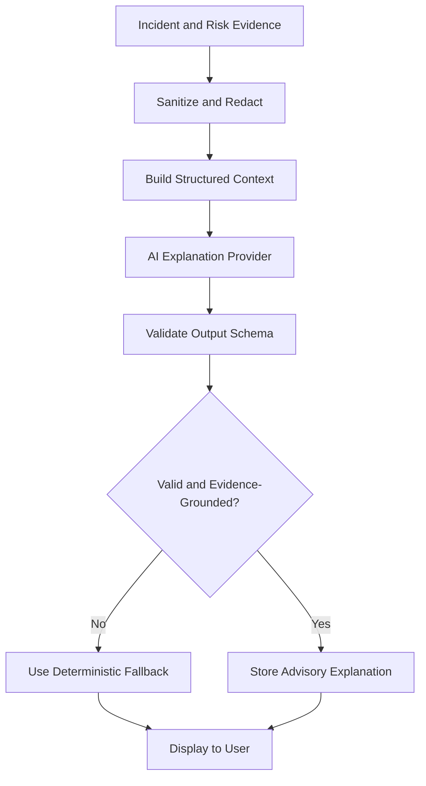

# FlagForge — Self-Hosted Deployment

> Self-host FlagForge and connect it to Flagsmith Cloud or a self-hosted Flagsmith instance. This document describes the intended deployment architecture and operational flow. Verify environment variable names and compose service definitions against the actual implementation before release.

## 1. Overview

FlagForge is a feature-release intelligence platform. It combines:
- Flagsmith integration for feature configuration.
- Static code scanning and flag-reference discovery.
- Dependency mapping.
- Isolated release simulations.
- OpenTelemetry-based runtime monitoring.
- Deterministic risk assessment.
- Policy-governed and verified rollback.
- AI-generated explanations that cannot authorize actions.

Flagsmith remains the source of truth for feature-flag state. FlagForge stores a local read model, evidence, snapshots, risk assessments and audit history.

## 2. Self-hosted deployment topology



### Services

| Service | Responsibility | Persistence |
|---|---|---|
| `web` | Dashboard and visualizations | None |
| `api` | REST API, auth, integration adapter and policies | PostgreSQL |
| `worker` | Scans, simulations, telemetry aggregation and rollback jobs | PostgreSQL/Redis |
| `postgres` | Application data | Named volume |
| `redis` | Queue, cache and distributed locks | Optional persistence |
| `otel-collector` | Receives and forwards telemetry | Depends on exporter |
| `demo-app` | Reproducible feature-flag demo and telemetry | None |
| Flagsmith | Feature flag system of record | Managed separately or separately hosted |

## 3. Prerequisites

- Docker Engine and Docker Compose plugin.
- Git.
- A supported Flagsmith instance (Cloud or self-hosted).
- A Flagsmith Management API credential with only the permissions required by the integration.
- Optional GitHub App credentials for repository scanning.
- Optional LLM API key for explanations; core safety features must work without it.
- A host with sufficient CPU, memory and disk for the selected services.

Do not commit `.env`, credentials, private keys or production snapshots.

## 4. Quick start

The commands below describe the intended workflow. Adjust them to match the actual repository scripts and service names.

```bash
git clone <YOUR_FLAGFORGE_REPOSITORY>
cd flagforge
cp .env.example .env
```

Generate strong, unique secrets for the application session key, encryption key and database password. Configure the environment values described below, then start the stack:

```bash
docker compose up --build -d
docker compose ps
```

Run database migrations using the repository's migration command, for example:

```bash
docker compose exec api alembic upgrade head
```

Check service health:

```bash
docker compose ps
curl http://localhost:<API_PORT>/health
```

Open the web application at the configured local URL. Sign in, create an organization and project, then connect Flagsmith.

### Environment configuration

The exact variable names must match `.env.example`. A recommended configuration inventory:

| Setting | Purpose |
|---|---|
| `APP_ENV` | `development`, `staging` or `production` |
| `APP_SECRET_KEY` | Session/signing secret |
| `ENCRYPTION_KEY` | Encrypt integration credentials |
| `DATABASE_URL` | PostgreSQL connection |
| `REDIS_URL` | Redis connection |
| `WEB_BASE_URL` | Public web URL |
| `API_BASE_URL` | API URL |
| `FLAGSMITH_BASE_URL` | Flagsmith instance URL |
| `FLAGSMITH_MANAGEMENT_TOKEN` | Prefer per-connection encrypted storage rather than a global token |
| `GITHUB_APP_ID` | Optional GitHub App ID |
| `GITHUB_PRIVATE_KEY` | Optional GitHub App private key; use a secret manager |
| `OTEL_EXPORTER_OTLP_ENDPOINT` | Telemetry collector endpoint |
| `LLM_API_KEY` | Optional explanation provider |
| `AUTO_ROLLBACK_DEFAULT` | Default should be disabled until explicitly configured |

Never put server credentials in `NEXT_PUBLIC_*` variables.

## 5. Connecting Flagsmith

1. Open FlagForge Integrations.
2. Choose Flagsmith Cloud or self-hosted.
3. Enter the instance base URL.
4. Supply the Management API credential through the secure backend form.
5. Test the connection.
6. Select the intended Flagsmith project and environments.
7. Run an initial sync.
8. Confirm the remote project/environment identifiers and flag list.

The backend adapter must use the current official Flagsmith API documentation. Do not assume endpoint paths or payload schemas from examples written for another API version.

### Integration data flow



## 6. Internal architecture and algorithms

### 6.1 Repository scanner

**Input:** repository URL/installation, branch and commit SHA.

**Algorithm:**
1. Validate repository ownership and installation permissions.
2. Fetch source using GitHub's supported API or a restricted checkout.
3. Pin the scan to a commit SHA.
4. Exclude generated, vendored, binary, dependency and ignored paths.
5. Select a parser based on file type.
6. Parse source into an AST using Tree-sitter or a language-specific parser.
7. Match configured Flagsmith SDK call patterns and project-specific wrappers.
8. Record flag key, file, line, symbol, pattern and evidence.
9. Match references to synchronized Flagsmith records.
10. Save findings and scan summary.

**Important:** Do not execute repository code. A static scan cannot prove a flag is unused merely because no reference was found.



### 6.2 Dependency analysis

Each relationship is stored with an evidence type:
- `explicit`: developer annotation or direct declared dependency.
- `inferred`: static code path or shared condition suggests a relationship.
- `manual`: a developer entered it.

**Algorithm:**
1. Create nodes for flags, code components, services and APIs.
2. Extract explicit dependency annotations.
3. Link references to containing functions/components.
4. Detect shared conditions and nested flag checks.
5. Add inferred edges with evidence and confidence.
6. Deduplicate edges and preserve provenance.
7. Calculate reachable nodes for impact analysis.
8. Render the graph and clearly label inferred edges.

Do not claim an inferred relationship is guaranteed runtime behaviour.



### 6.3 Chaos Lab simulation

Chaos Lab is restricted to an isolated staging/test environment or disposable demo project.

**Algorithm:**
1. Validate target environment is permitted for simulation.
2. Acquire a simulation lock.
3. Read and persist the complete relevant initial configuration.
4. Validate scenario flags and expected outcomes.
5. Apply temporary changes using the Flagsmith adapter.
6. Read back and verify each change.
7. Run controlled test traffic and assertions.
8. Collect error, latency and functional results.
9. Restore original state in a guaranteed cleanup/compensation step.
10. Read back and verify restoration.
11. Mark the run complete only after restoration is confirmed.
12. Escalate if restoration cannot be verified.



### 6.4 Runtime monitoring

Instrument the demo application and supported customer services with OpenTelemetry. Use bounded-cardinality attributes such as service, environment, release and feature key. Avoid user IDs or other high-cardinality/sensitive labels in metric dimensions.

For a time window:

- `request_count = total eligible requests`
- `error_count = requests meeting configured error definition`
- `error_rate = 100 * error_count / request_count`
- `latency_p95 = 95th percentile request latency`

Compare current windows with a configured baseline. Require a minimum sample count and consecutive breach windows. If attribution is absent, report service-level health rather than asserting a specific flag caused the issue.



### 6.5 Deterministic risk algorithm

Initial illustrative model, with each input normalized from 0 to 100:

`risk = 0.30D + 0.25E + 0.20L + 0.15C + 0.10V`

Where:
- `D`: dependency impact
- `E`: error anomaly
- `L`: latency anomaly
- `C`: change criticality
- `V`: rollout velocity

Initial illustrative bands:
- 0–29: low
- 30–49: moderate
- 50–74: high
- 75–100: critical

Weights and bands must be versioned and configurable. Hard policy rules take precedence over the weighted score. Missing data must not be silently treated as healthy.



### 6.6 Rollback algorithm

Automatic rollback is allowed only if the environment policy enables it and every required precondition passes.

Preconditions include:
- valid project/environment/flag mapping
- recent valid previous-state snapshot
- no conflicting manual state change since snapshot
- adequate telemetry sample and exposure
- sustained configured breach
- protected-flag and allowlist checks
- no active cooldown
- attempt limit not exceeded
- valid credential and reachable Flagsmith instance
- distributed lock acquired

**Execution:**
1. Create incident and immutable audit event.
2. Evaluate policy using deterministic code.
3. If any check fails, alert/escalate without mutation.
4. Create an idempotent rollback intent.
5. Persist the desired previous state.
6. Call the Flagsmith Management API through the adapter.
7. Read remote state back.
8. Mark success only if it matches the desired state.
9. If response is uncertain, reconcile by reading remote state before retrying.
10. Record verification, notify users and start cooldown.



Rollback changes a feature configuration. It does not reverse data migrations, repair corrupted data or undo irreversible side effects.

### 6.7 Hybrid AI explanation

AI receives sanitized structured evidence and produces explanations. It does not authorize or execute privileged actions.

**Algorithm:**
1. Fetch incident, risk, graph and telemetry evidence.
2. Remove secrets and sensitive fields.
3. Construct a bounded, structured prompt.
4. Request schema-constrained explanation.
5. Validate output and evidence references.
6. Store as advisory content.
7. Display the deterministic decision separately from the AI explanation.



## 7. Database and data lifecycle

Use PostgreSQL with SQLAlchemy and Alembic. Core entities include users, organizations, memberships, projects, environments, Flagsmith connections, repositories, feature flags, snapshots, scans, references, dependencies, simulations, telemetry aggregates, releases, risk assessments, policies, incidents, rollback actions, audit logs and webhook events.

Operational rules:
- Scope every tenant-owned query to the authenticated organization.
- Encrypt integration credentials at rest.
- Store timestamps in UTC.
- Index project, environment, flag, incident and time-window query paths.
- Keep audit and rollback records append-only.
- Aggregate telemetry into time buckets and define retention.
- Back up PostgreSQL and test restore procedures.
- Use an outbox or durable job record for reliable background processing.

## 8. Security checklist

- [ ] TLS at the reverse proxy.
- [ ] Strong unique application/database/encryption secrets.
- [ ] No secrets in frontend bundles or logs.
- [ ] Organization-scoped RBAC.
- [ ] Webhook signature validation and replay protection.
- [ ] GitHub least-privilege permissions.
- [ ] SSRF defenses for custom Flagsmith URLs (block metadata/private destinations unless explicitly and safely configured).
- [ ] Request timeouts and allowlisted URL schemes.
- [ ] Rate limiting and input validation.
- [ ] Isolated workers for untrusted repository processing.
- [ ] Production automation disabled until policy is explicitly configured.
- [ ] Rollback kill switch and audit trail.
- [ ] Backup/restore test.

## 9. Operations and troubleshooting

Useful operational checks:
```bash
docker compose ps
docker compose logs -f api
docker compose logs -f worker
docker compose logs -f postgres
docker compose logs -f redis
```

Common failure classes:
- Flagsmith connection: verify base URL, TLS, credential scope, network route and API compatibility.
- Sync mismatch: inspect remote identifiers, pagination, environment selection and webhook backlog.
- Scan failure: inspect repository permissions, commit SHA, parser support and file exclusions.
- Worker backlog: inspect Redis connectivity, worker health and retry/dead-letter state.
- Missing telemetry: verify OTel endpoint, instrumentation, resource attributes and collector export errors.
- Rollback not executed: inspect policy decision, sample sufficiency, snapshot age, cooldown, lock, protected flag and audit event. A refusal may be the correct safe outcome.

## 10. Backup, upgrades and production readiness

Before production:
1. Configure TLS and a trusted domain.
2. Use managed or hardened PostgreSQL/Redis where appropriate.
3. Set a backup schedule and test restore.
4. Configure secret rotation.
5. Configure telemetry retention and resource limits.
6. Pin container image versions.
7. Run migrations as a controlled deployment step.
8. Start with rollback in `monitor` or `approval_required` mode.
9. Test in staging with injected faults.
10. Enable automatic rollback only after reviewing policy, thresholds and audit records.

## 11. Self-hosted acceptance test

A successful deployment should demonstrate:
1. Clean Docker startup and health checks.
2. User can create an organization and project.
3. Real Flagsmith instance connects and syncs.
4. Repository scan finds known sample flags.
5. Dependency graph displays evidence labels.
6. Chaos scenario runs only in staging and restores state.
7. Demo telemetry appears in the dashboard.
8. Risk calculation is repeatable.
9. Eligible test rollback updates and verifies Flagsmith state.
10. Invalid snapshot or insufficient telemetry blocks rollback.
11. AI provider can be absent without breaking core features.

## 12. Official references

- Flagsmith documentation: https://docs.flagsmith.com/
- Flagsmith self-hosting: https://docs.flagsmith.com/deployment-self-hosting/
- Flagsmith Management API: https://docs.flagsmith.com/
- OpenTelemetry: https://opentelemetry.io/docs/
- Docker Compose: https://docs.docker.com/compose/
- FastAPI: https://fastapi.tiangolo.com/
- GitHub Apps: https://docs.github.com/en/apps

> This README is an implementation blueprint. Update commands, ports, environment variable names and service names to match the tested repository. Never describe an unimplemented capability as available.
