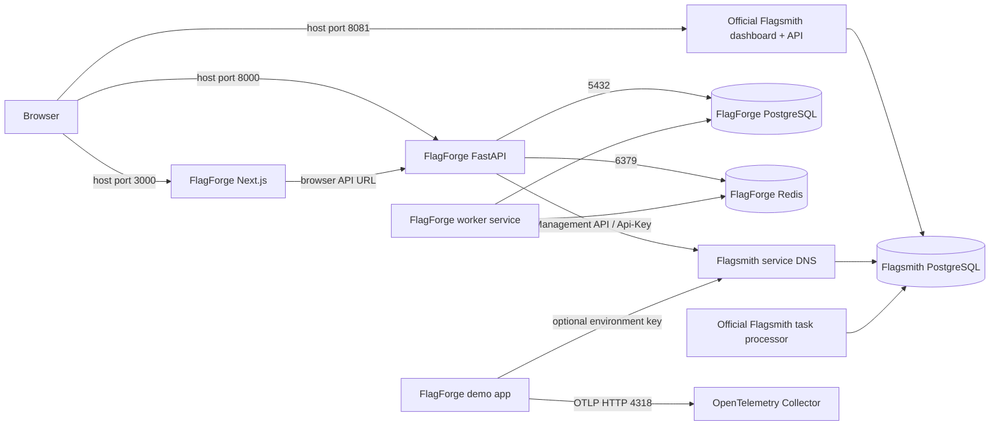

# FlagForge and Flagsmith architecture

All containers join `flagforge-net`. Flagsmith is the official self-hosted v2.295.2 image; its dashboard and API share container port 8000. It is published on host port 8081, separate from FlagForge's API on host port 8000. The service name `flagsmith` is resolvable by FlagForge containers.

Postgres and volumes are separate:

- `postgres` / `flagforge_postgres_data`: FlagForge users, orgs, integrations, synchronized snapshots and intelligence data.
- `flagsmith-postgres` / `flagsmith_postgres_data`: official Flagsmith application data.

FlagForge talks to supported Flagsmith Management API endpoints and stores its synchronized copies in its own schema. It never queries Flagsmith's SQL schema. The Organization API key remains backend-side and is encrypted at rest.

## Current flow boundaries

Manual Flagsmith sync currently runs synchronously from the FlagForge API request. It tests the Management API credential, retrieves projects/environments/features/states, and writes idempotent snapshots to FlagForge Postgres. The displayed FlagForge worker service remains a placeholder and is not in this sync path. The Collector receives OTLP and exposes transformed Prometheus metrics; FlagForge does not yet persist those metrics into its tenant telemetry tables. These are open implementation gaps, not demonstrated end-to-end features.
