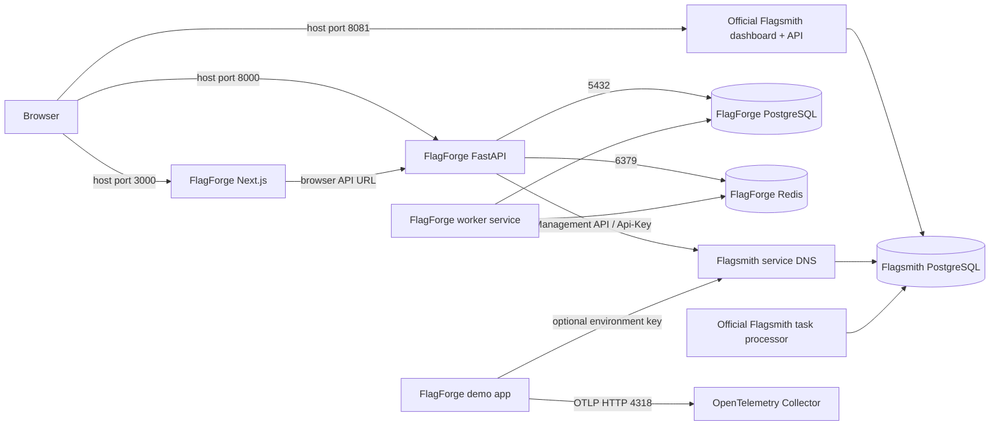

# FlagForge and Flagsmith architecture

All containers join `flagforge-net`. Flagsmith is the official self-hosted v2.295.2 image; its dashboard and API share container port 8000. It is published on host port 8081, separate from FlagForge's API on host port 8000. The service name `flagsmith` is resolvable by FlagForge containers.

Postgres and volumes are separate:

- `postgres` / `flagforge_postgres_data`: FlagForge users, orgs, integrations, synchronized snapshots and intelligence data.
- `flagsmith-postgres` / `flagsmith_postgres_data`: official Flagsmith application data.

FlagForge talks to supported Flagsmith Management API endpoints and stores its synchronized copies in its own schema. It never queries Flagsmith's SQL schema. The Organization API key remains backend-side and is encrypted at rest.

## Current flow boundaries

Flagsmith Management API calls use the configured service DNS name and are restricted by FlagForge's outbound host allowlist. Sync is idempotent and can be queued through the Redis Streams worker, whose job state is persisted in FlagForge Postgres. Repository scanning uses the same durable job mechanism. The worker has restart recovery, bounded retry/backoff and health reporting.

The demo app sends OTLP/HTTP JSON through the Collector to FlagForge's authenticated ingestion endpoint. The API persists request/error counts and histogram buckets with organization, project, service and environment attribution. Runtime Monitor derives latency percentiles from merged buckets, and the deterministic Risk Engine uses the persisted observations. The sample app is an isolated QA/demo source, not customer traffic.

Native Flagsmith environment webhooks use a signed raw-body callback. The local Compose deployment trusts only the exact `api.flagforge.local` hostname using Flagsmith's supported `SSRF_ALLOWED_HOSTS` setting; the provider SSRF validator remains enabled for other hosts. A signed provider test event and two Staging flag updates were received, processed and synchronized in the local QA deployment. The temporary webhook and signing secret were removed and the test flag was restored.

GitHub cleanup PR support requires a configured GitHub App or authorized fine-grained token. It creates a reviewed single-file change on a separate branch and opens a PR without merging. No external GitHub credentials are configured in this environment. Remote rollback stays disabled because the provider API does not provide the conditional-write/concurrency guarantee needed to promise race-safe restoration.
