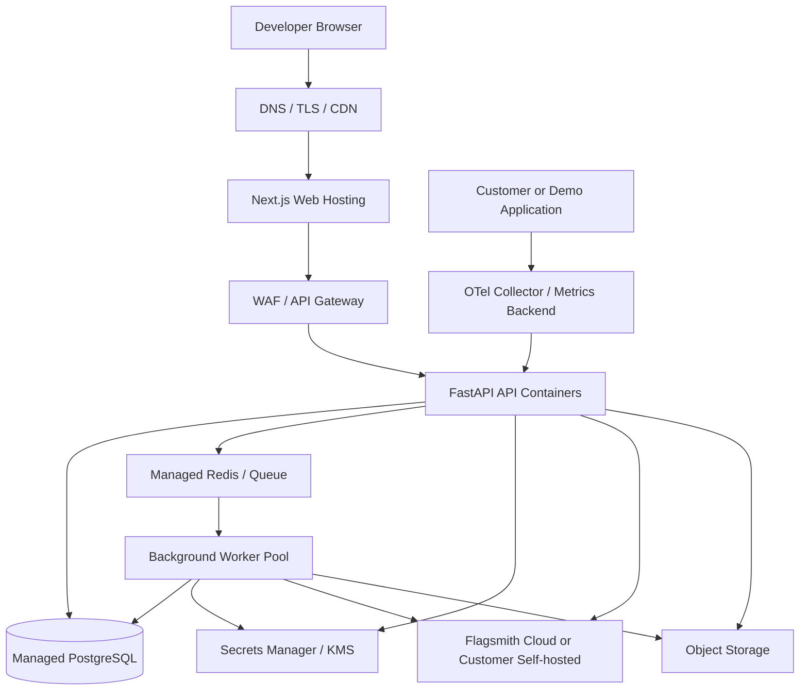
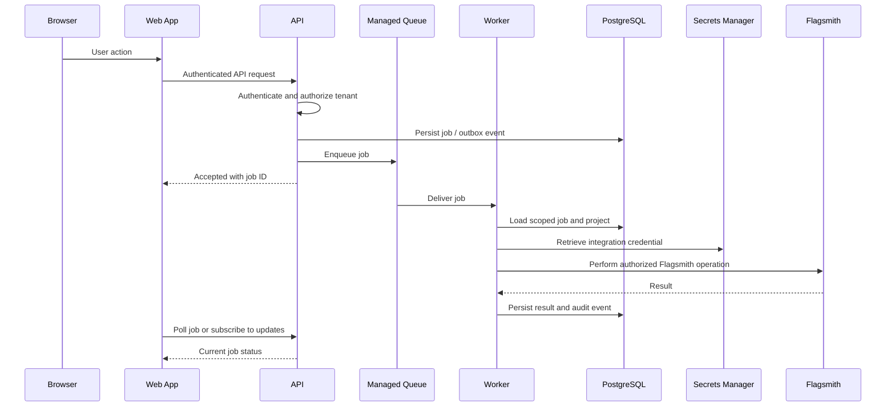
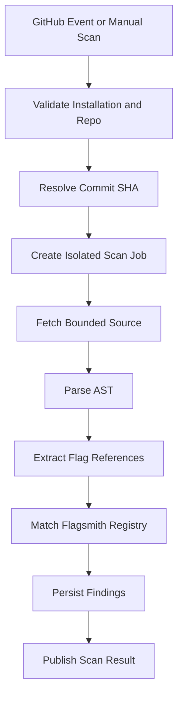
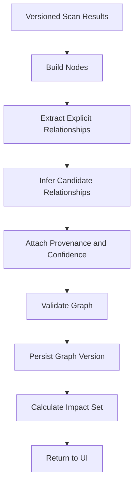
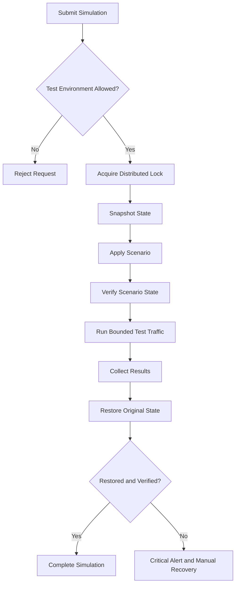
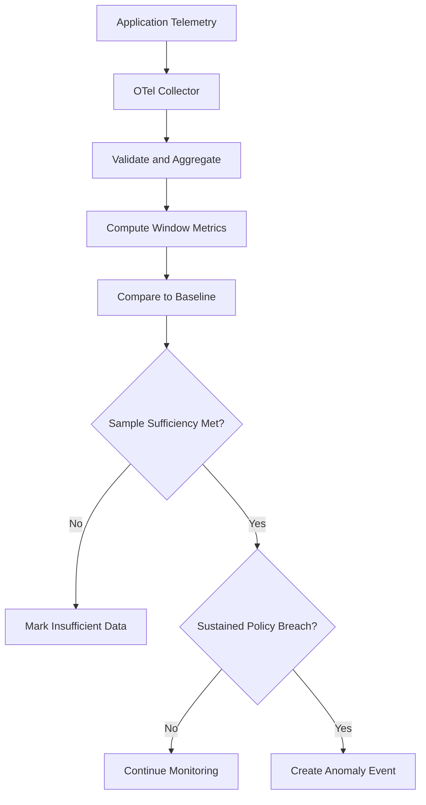
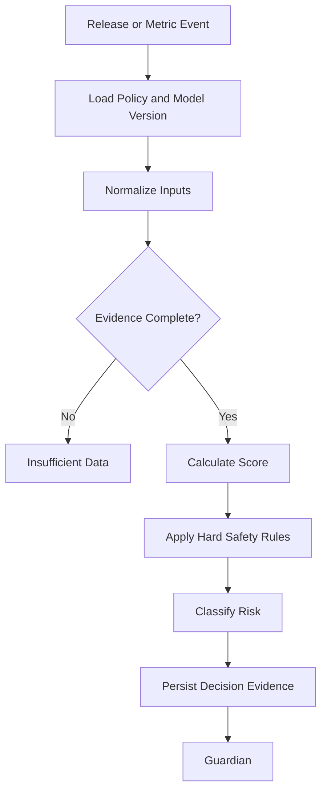
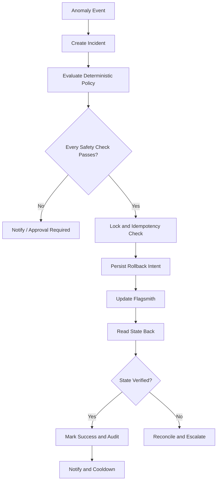
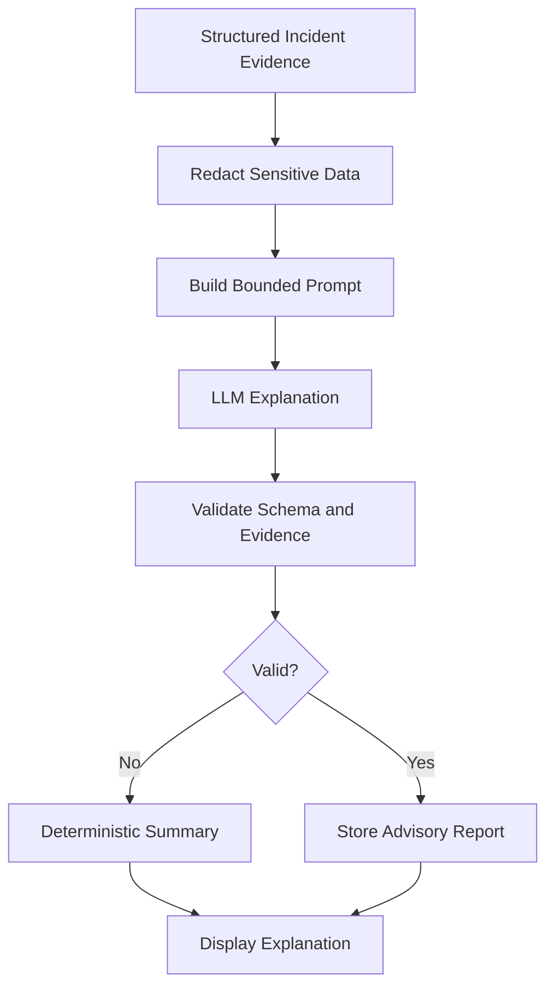
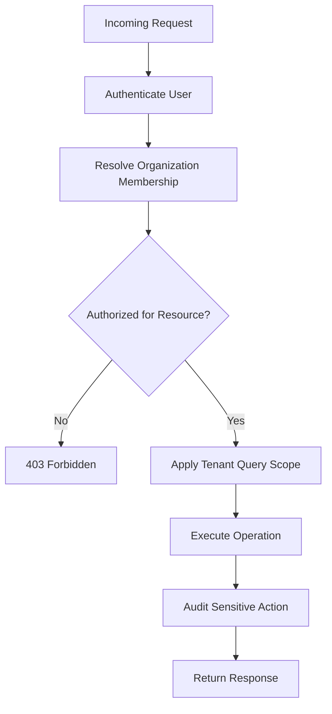

> **Archived future-deployment draft — not supported or implemented.** No cloud resources, manifests or deployment workflow are provided by this document. It contains aspirational architecture and must not be followed as a tested deployment guide. The supported setup is local Docker Compose.
# FlagForge — Cloud Deployment

> Cloud deployment guide for FlagForge. The platform uses the same application code and database model as the self-hosted edition. Cloud infrastructure changes how services are hosted, scaled, secured and operated; it does not change the product's core algorithms.

## 1. Overview

FlagForge is a feature-release intelligence platform integrated with Flagsmith. It provides code scanning, dependency analysis, isolated simulations, runtime telemetry, deterministic risk assessment, policy-governed rollback and AI explanations.

Cloud mode is intended for teams that prefer managed infrastructure. FlagForge can connect to either Flagsmith Cloud or a separately hosted Flagsmith instance.

## 2. Reference cloud architecture

### Cloud components

| Component | Recommended responsibility |
|---|---|
| DNS/CDN/TLS | Secure ingress and static delivery |
| Web hosting | Next.js frontend |
| API containers | FastAPI business logic |
| Worker pool | Scans, simulations, sync, telemetry jobs and rollback |
| Managed PostgreSQL | Persistent tenant data |
| Managed Redis | Queue, cache, locks and rate-limit state |
| Secrets manager/KMS | Integration credentials and encryption keys |
| Object storage | Scan artifacts, reports and larger outputs |
| OTel backend | Metrics, traces and service health |
| Flagsmith | External feature flag system of record |

Use a cloud provider of choice. Keep provider-specific resources behind deployment configuration and infrastructure-as-code modules.

## 3. Cloud deployment principles

1. Stateless web/API containers; persist state in managed services.
2. Separate API and worker scaling.
3. Use private networking for database and Redis.
4. Use a managed secrets service or KMS.
5. Require TLS for all public and service-to-service traffic where supported.
6. Use per-tenant authorization and database query scoping.
7. Keep rollback execution in a worker with explicit policy checks.
8. Use health checks, readiness probes and graceful shutdown.
9. Use database backups and point-in-time recovery where available.
10. Keep cloud and self-hosted editions on the same codebase.

## 4. Deployment sequence

The exact commands depend on the selected cloud provider and repository configuration. A provider-neutral sequence is:

1. Create a cloud project/account and isolated production environment.
2. Create a private network and security groups/firewall rules.
3. Provision managed PostgreSQL and Redis.
4. Provision a secrets manager and encryption key.
5. Build and publish immutable frontend, API and worker images.
6. Deploy database migrations as a one-off controlled job.
7. Deploy API and worker containers.
8. Deploy the frontend and configure its API origin.
9. Configure DNS, TLS, WAF and rate limits.
10. Configure OTel collector/exporter and alerts.
11. Connect Flagsmith and GitHub integrations.
12. Run end-to-end acceptance tests before onboarding tenants.

Do not put credentials in build arguments, frontend environment variables or source control. Inject secrets at runtime through the cloud secret manager.

## 5. Cloud configuration inventory

Use the same application configuration as self-hosted deployment, with managed service URLs.

| Configuration | Cloud handling |
|---|---|
| `APP_ENV` | Set to `production` |
| `APP_SECRET_KEY` | Secret manager |
| `ENCRYPTION_KEY` | KMS-backed or secret-manager protected |
| `DATABASE_URL` | Private managed PostgreSQL endpoint |
| `REDIS_URL` | Private managed Redis endpoint |
| `WEB_BASE_URL` | Public HTTPS frontend |
| `API_BASE_URL` | Public HTTPS API |
| `OTEL_EXPORTER_OTLP_ENDPOINT` | Private collector or approved endpoint |
| GitHub App keys | Secret manager |
| Flagsmith credentials | Encrypted per connection |
| LLM API key | Optional secret; AI remains non-authoritative |

The exact names must match the application's `.env.example` and deployment manifests.

## 6. Cloud request and job flow

## 7. Algorithms and processing flows

### 7.1 Code scanning in cloud

Run scanning in isolated, short-lived workers. Do not run repository scripts or build steps as part of static analysis.

**Algorithm:**
1. Authenticate GitHub installation and verify repository access.
2. Resolve branch to a commit SHA.
3. Fetch only required source content.
4. Enforce repository size, file count, timeout and archive limits.
5. Exclude binaries, generated files, dependencies and configured ignored paths.
6. Parse supported source files with language-specific AST parsers.
7. Match configured Flagsmith SDK patterns.
8. Persist references with commit SHA, path, line, parser evidence and confidence.
9. Match against the project's synchronized Flagsmith registry.
10. Produce a scan summary and cleanup suggestions.

### 7.2 Dependency graph algorithm

1. Build nodes from scanner references and known services.
2. Add explicit dependencies from annotations/configuration.
3. Infer candidate edges from nested conditions, shared code paths and service relationships.
4. Attach evidence type and confidence.
5. Deduplicate and validate graph edges.
6. Persist graph version tied to repository commit SHA.
7. Calculate affected-node reachability for a proposed flag change.
8. Return graph plus evidence to the frontend.

Inferred edges must be visually different from explicit/manual edges.

### 7.3 Chaos Lab algorithm

Cloud simulations run in a dedicated isolated environment. Production environments are rejected by default.

1. Validate organization, project and environment.
2. Check simulation policy and environment allowlist.
3. Acquire distributed lock.
4. Snapshot relevant flag configuration.
5. Apply scenario changes through Flagsmith adapter.
6. Verify temporary state.
7. Run bounded test traffic against the designated test target.
8. Collect OpenTelemetry metrics and functional assertions.
9. Restore the snapshot even if test execution fails.
10. Verify restoration.
11. Persist result and release lock.
12. Escalate any uncertain restoration state.

### 7.4 Runtime monitoring and anomaly detection

Use OpenTelemetry instrumentation and collector pipelines. Prefer service/environment/release/feature attributes with bounded cardinality.

For each configured time window:
- Calculate request count.
- Calculate error count and error rate.
- Calculate p50/p95/p99 latency as required.
- Compare current values with baseline.
- Check minimum samples and consecutive breach windows.
- Record missing or delayed telemetry.
- Attach feature attribution only when instrumentation provides it.

Correlation between a release and an error increase is evidence for investigation, not proof of causality.

### 7.5 Deterministic release risk

Use a versioned, deterministic formula with normalized inputs:

`risk = 0.30D + 0.25E + 0.20L + 0.15C + 0.10V`

Where:
- `D` = dependency impact
- `E` = error anomaly
- `L` = latency anomaly
- `C` = change criticality
- `V` = rollout velocity

Initial example bands: low 0–29, moderate 30–49, high 50–74, critical 75–100.

The policy engine also checks hard thresholds, sample size, exposure, sustained windows, environment protections and missing evidence. A score never overrides a policy prohibition.

### 7.6 Policy-governed automatic rollback

Rollback is an external configuration mutation and must be treated as a privileged, auditable operation.

Preconditions:
- automatic mode enabled for the specific environment
- valid and sufficiently recent prior snapshot
- no conflicting manual update
- valid flag/project/environment mapping
- telemetry sufficiency and sustained configured breach
- exposure and sample thresholds met
- flag not protected
- cooldown and attempt limits satisfied
- valid credential and reachable Flagsmith
- distributed lock and idempotency checks pass

Execution:
1. Create incident and audit event.
2. Evaluate policy deterministically.
3. Refuse mutation if any precondition fails.
4. Persist rollback intent and target state.
5. Call the Flagsmith adapter.
6. Read remote configuration back.
7. Mark success only after state verification.
8. Reconcile uncertain responses before retry.
9. Notify and apply cooldown.
10. Preserve all evidence.

Rollback does not reverse data migrations or irreversible side effects. A successful flag-state update is not proof that service health recovered.

### 7.7 AI explanation algorithm

AI is advisory only.

1. Load structured risk, graph, telemetry and incident evidence.
2. Redact credentials, personal data and sensitive content.
3. Construct a bounded context with evidence IDs.
4. Request a structured explanation from the configured model.
5. Validate schema and references.
6. Store the result as an advisory report.
7. Show deterministic decision and AI explanation separately.
8. If the provider is unavailable, display a deterministic summary.

AI must never receive tools or credentials that allow it to mutate Flagsmith or authorize rollback.

## 8. Cloud data model and tenancy

Use the same PostgreSQL schema as self-hosted mode. Main entities:

- `users`, `organizations`, `organization_members`
- `projects`, `environments`
- `flagsmith_connections`, `feature_flags`, `flag_snapshots`
- `repositories`, `scans`, `flag_references`, `dependencies`
- `simulations`, `simulation_steps`
- `telemetry_aggregates`, `releases`, `risk_assessments`
- `rollback_policies`, `incidents`, `rollback_actions`
- `audit_logs`, `webhook_events`, `ai_reports`

### Tenant isolation algorithm

For every request:
1. Authenticate the principal.
2. Resolve organization membership.
3. Verify role and resource ownership.
4. Scope the database query by organization/project.
5. Perform the operation.
6. Write an audit record for sensitive actions.

Use database constraints and, where appropriate, PostgreSQL Row-Level Security as defense in depth. Do not rely only on frontend route hiding.

## 9. Scaling and reliability

### Horizontal scaling
- Scale API containers based on request load and latency.
- Scale workers based on queue depth and job duration.
- Keep scan and simulation workers isolated from API containers.
- Apply per-tenant quotas for scans, simulations and telemetry.
- Use bounded concurrency for external API calls.
- Apply exponential backoff with jitter for retryable errors.
- Use dead-letter handling for exhausted jobs.
- Use idempotency keys for webhooks, jobs and rollback actions.

### Database
- Use managed backups and point-in-time recovery.
- Monitor connection count and query latency.
- Use connection pooling.
- Add indexes for tenant/project/environment/time queries.
- Partition or expire telemetry aggregates as volume grows.
- Run migrations as a controlled release step, not on every replica startup.

### Secrets
- Use KMS/secret-manager encryption.
- Rotate integration credentials.
- Keep GitHub private keys and Flagsmith tokens server-side.
- Redact secrets from errors and logs.
- Restrict secret access to the smallest service role.

## 10. Cloud security checklist

- [ ] Public services use HTTPS.
- [ ] Database and Redis are private.
- [ ] WAF and rate limits protect public ingress.
- [ ] Secrets are injected at runtime.
- [ ] Organization-level authorization is enforced server-side.
- [ ] GitHub App permissions are least privilege.
- [ ] Webhook signatures and replay protection are implemented.
- [ ] Custom Flagsmith URL input is protected against SSRF.
- [ ] Worker containers have CPU/memory/time limits.
- [ ] Repository code is never executed by the scanner.
- [ ] Production rollback requires explicit policy.
- [ ] Rollback actions are idempotent and verified.
- [ ] Audit logs are retained and access-controlled.
- [ ] Backups and restore procedures are tested.
- [ ] Alerts exist for API, worker, queue, database and integration failures.

## 11. Cloud observability and operations

Monitor:
- API request rate, error rate and latency.
- Worker queue depth, execution time and failure count.
- PostgreSQL connections, storage, CPU and slow queries.
- Redis memory, latency and evictions.
- Flagsmith API latency, rate limits and failed mutations.
- Telemetry ingestion delay and dropped data.
- Scan and simulation duration.
- Rollback attempts, refusals, verification failures and cooldowns.

Keep product telemetry separate from platform telemetry. Never use high-cardinality or sensitive user attributes as metric labels.

## 12. Release and rollback operational runbook

Before enabling automatic rollback in a cloud tenant:
1. Start in monitor-only mode.
2. Validate telemetry and feature attribution.
3. Test the policy in staging.
4. Test stale snapshot and concurrent manual-change rejection.
5. Test duplicate webhook/job delivery.
6. Test Flagsmith timeout and uncertain mutation response.
7. Verify state reconciliation.
8. Review protected flags and cooldown.
9. Enable automatic mode for one low-risk flag/environment.
10. Review audit records and incident outcomes before broader enablement.

A global emergency switch must disable automated mutations without disabling monitoring or incident reporting.

## 13. Cloud acceptance criteria

A cloud deployment is ready for pilot use when:
1. Tenant A cannot access Tenant B resources.
2. Real Flagsmith Cloud or self-hosted integration works.
3. Flag sync and webhook processing are idempotent.
4. GitHub scans are pinned to commit SHA and do not execute repository code.
5. Dependency graph labels evidence and confidence.
6. Chaos Lab refuses production targets and restores test state.
7. OpenTelemetry metrics are visible with correct environment attribution.
8. Risk scores are deterministic and versioned.
9. Insufficient telemetry blocks automatic rollback.
10. Rollback updates and verifies Flagsmith state.
11. Failed or uncertain updates are reconciled safely.
12. AI cannot authorize or execute mutations.
13. Backups, restore and secret rotation are documented.
14. API, worker and database can be scaled independently.

## 14. Official references

- Flagsmith: https://docs.flagsmith.com/
- Flagsmith deployment: https://docs.flagsmith.com/deployment-self-hosting/
- OpenTelemetry: https://opentelemetry.io/docs/
- Docker: https://docs.docker.com/
- Kubernetes (if used): https://kubernetes.io/docs/
- FastAPI: https://fastapi.tiangolo.com/
- GitHub Apps: https://docs.github.com/en/apps
- PostgreSQL: https://www.postgresql.org/docs/
- Redis: https://redis.io/docs/

> This README describes the target cloud architecture. It is not proof that cloud infrastructure has already been provisioned. Update provider-specific commands, resource names, ports, environment variables and deployment manifests to match the tested implementation.
